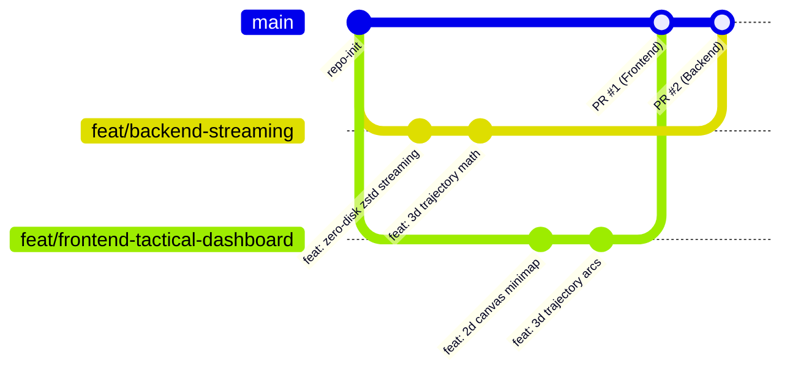

# BreachIQ 3D — Dual-Track Collaboration & Development Guide

> **Project:** BreachIQ 3D / C9 SightLine  
> **Hackathon:** Sky's the Limit 2026: Cloud9 × JetBrains (Category 1 · VALORANT Tactical Scouting)  
> **Team Division:**  
> - **Track A (Backend & Data Streaming Lead):** Ashiq Hussain (`mir-ashiq`)  
> - **Track B (Frontend & Tactical UI / JetBrains Workflow Lead):** Sann (`steavengalang`)  

---

## 1. Core Workflow & Branching Strategy

To keep the GitHub contribution graph balanced (~50/50 split) and preserve git history integrity, both members will work on isolated feature branches and merge into `main` via GitHub Pull Requests.



### Branch Naming Conventions
- **Track A (Backend):** `feat/backend-<feature-name>` (e.g., `feat/backend-real-streamer`, `feat/backend-lineup-detector`)
- **Track B (Frontend):** `feat/frontend-<feature-name>` or `feat/tactical-<feature-name>` (e.g., `feat/tactical-minimap-dashboard`, `feat/tactical-filters`)
- **Shared / Hotfix:** `fix/<bug-name>` or `docs/<doc-name>`

### Pull Request & Attribution Rules
1. **Never push directly to `main`:** All code lands via PR review.
2. **Co-Authorship for Shared Work:** When collaborating on API contracts or submission files, add this trailer to commit messages:
   ```text
   Co-authored-by: mir-ashiq <164319409+mir-ashiq@users.noreply.github.com>
   Co-authored-by: steavengalang <steavengalang@gmail.com>
   ```
3. **Local Git Identity Configuration:**
   Make sure your local machine uses your verified GitHub email before committing:
   ```bash
   git config --global user.name "steavengalang"
   git config --global user.email "steavengalang@gmail.com"
   ```

---

## 2. Track Division & Technical Ownership

### Track A: Backend, Data Streaming & 3D Math Engine (Lead: Ashiq)
- **Directory Scope:** `breachiq/`, `fixtures/`, `scripts/`, `tests/`
- **Key Responsibilities:**
  1. **Zero-Disk Streaming Reader (`breachiq/corpus.py`, `breachiq/ingest.py`):**
     - Streaming decompressed chunks of `.jsonl.zst` telemetry on-the-fly without dumping raw files to disk.
     - Enforcing memory caps ($\le 512$ MB RSS) during batch processing.
  2. **Spatial Math & 3D Raycasting (`breachiq/spatial.py`):**
     - Calibrated map coordinate normalization using `BOUNDS`.
     - Pitch elevation ($\theta$) and azimuth ($\phi$) calculation from 3D unit aim vectors.
     - Fallback handling for 1 Hz telemetry and interpolation between `frame_before` / `frame_after`.
  3. **Event Detection & API Endpoints (`breachiq/api.py`, `breachiq/features.py`):**
     - Exposing `/api/meta`, `/api/atlas`, `/api/operator`, `/api/pacing`, `/api/lineups`, `/api/brief.pdf`.
     - Ensuring **0% licensed data** is leaked or committed into the repository.

### Track B: Frontend, Tactical Visualizer & AI Story (Lead: Sann)
- **Directory Scope:** `web/`, `AI_SHOWCASE.md`, `docs/`, `DEVPOST.md`
- **Key Responsibilities:**
  1. **Minimap Canvas Visualizer (`web/app.js`):**
     - HTML5 2D radar minimap canvas with tactical grid and site bounding boxes.
     - Dynamic 3D parabolic trajectory arcs rendered from caster coordinates $(u_0, v_0)$ to landing estimate $(u, v)$.
     - Aim cone azimuth vector ticks and repeated lineup reticles ($\star$).
  2. **Tactical UI / UX & Cloud9 Branding (`web/style.css`, `web/index.html`):**
     - High-contrast Cloud9 pro dark aesthetic (`#070a0f`, `#00aeff`, `#38bdf8`, JetBrains Mono).
     - Colorblind-safe luminance heatmap tiers (`--heat-1` through `--heat-4`).
     - Interactive tooltip inspection for hover over utility casts and lineup points.
     - Filter rail (Map, Side, Patch, Ability) with layer toggles.
  3. **JetBrains AI Assistant / Junie Story (`AI_SHOWCASE.md`):**
     - Documenting real AI interaction logs (prompts, agent outputs, human decisions).
     - Directly targeting the **25% judging weight** for the Best AI Workflow Story.
  4. **Submission Video & Devpost Packaging:**
     - 3-minute video walkthrough showcasing tactical value for Cloud9 coaches.

---

## 3. Strict Compliance & Repository Hygiene

> [!CAUTION]
> **Zero Proprietary Data Policy:** Never commit raw `.zst`, `.jsonl`, `.parquet`, or uncompressed GRID tournament telemetry files to GitHub. Any trace of licensed data will immediately disqualify the project.

- Always verify compliance before pushing:
  ```bash
  python scripts/audit_repo.py
  ```
- Always verify all unit tests pass:
  ```bash
  pytest tests/
  ```

---

## 4. Quick Start Guide for Development

### 1. Setting Up the Local Environment
```bash
# Clone the repository
git clone https://github.com/mir-ashiq/breachiq3d.git
cd breachiq3d

# Install dependencies (virtual environment recommended)
python -m venv .venv
source .venv/bin/activate  # On Windows: .venv\Scripts\activate
pip install -r requirements.txt
```

### 2. Running the FastAPI Backend
```bash
uvicorn breachiq.api:app --reload --port 8000
```
- Open documentation in browser: `http://localhost:8000/docs`
- Open tactical dashboard: `http://localhost:8000/app/index.html`

### 3. Running the Frontend Standalone (Demo Mode)
- Simply open `web/index.html` in your browser, or run a local static server:
  ```bash
  python -m http.server 3000 --directory web
  ```
- The dashboard automatically detects offline mode and pulls from `web/demo-data.json`.
